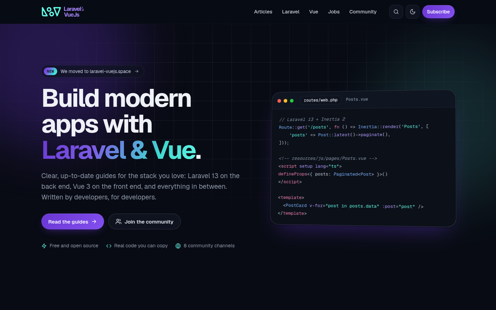

# Laravel & VueJs · laravel-vuejs.space

Open source blog and community for developers who build with **Laravel** and **Vue**: practical guides, developer tools, cheat sheets, community channels and a free jobs group. The site is a static [Astro](https://astro.build) build served by a Cloudflare Worker at **https://laravel-vuejs.space**. Contact: **contact@laravel-vuejs.space**.



## Stack

| Piece | Version (package.json / lock) | Role |
| --- | --- | --- |
| [Astro](https://astro.build) | `astro` ^7.3.8 | Static output (`output: 'static'`), no UI framework: every page is plain HTML and CSS |
| MDX | `@astrojs/mdx` ^8.0.3, `@astrojs/markdown-remark` ^7.3.2 | Posts in Markdown plus a few components |
| Shiki | `shiki` ^4.5.0, `@shikijs/transformers` ^4.5.0 | Build-time syntax highlighting (light + dark themes, line highlights, diff/focus notations) |
| RSS | `@astrojs/rss` ^4.0.19 | Feeds |
| Fonts | `@fontsource-variable/geist`, `geist-mono`, `newsreader` ^5.3.0 | Self-hosted Geist, Geist Mono and Newsreader |
| Cloudflare | `wrangler` ^4.149.0, `@cloudflare/workers-types` | Worker + static assets, D1, Email Service, cron |
| Tooling | `typescript` ^6.0.3, `@astrojs/check` ^0.9.10, `turndown` (+ GFM plugin) | Type checks; `turndown` turns built HTML into the `/<slug>.md` copies |

- Hand-written CSS design system (`src/styles/global.css`) with light and dark themes.
- About 9 KB of gzipped JavaScript per page: theme toggle, copy buttons, table-of-contents highlight, search, link prefetch. The developer tools under `/tools` add their own small inline scripts.
- Node.js >= 22.12 (`engines`); CI uses Node 24.

## Local development

```bash
npm install
cp .env.example .env   # optional: sponsor slot variables, all empty by default
npm run dev            # http://localhost:4321
npm run build          # dist/: astro build, then scripts/markdown.mjs (/<slug>.md, llms-full.txt) and scripts/csp.mjs (dist/_csp.json)
npm run preview        # serve dist/ with Astro
npm run cf:dev         # serve dist/ through the Worker (wrangler dev, http://localhost:8787); run npm run db:migrate:local first for the forms
```

Build-time variables you may set locally: `SHOW_FUTURE_POSTS=1` (include scheduled posts), `CHROME_PATH` (Chromium for OG cards, diagrams and PDFs), `MMDC` (Mermaid CLI path for diagrams).

## npm scripts

| Script | What it runs |
| --- | --- |
| `dev` | `astro dev` |
| `build` | `astro build && node scripts/markdown.mjs && node scripts/csp.mjs` |
| `preview` | `astro preview` |
| `cf:dev` | `wrangler dev` (Worker + `dist/` locally) |
| `deploy` | `wrangler deploy` (manual deploy; normally Workers Builds does this) |
| `check` | `astro check`: types and templates |
| `check:worker` | `tsc -p worker` |
| `check:links` | No internal link, image, script or stylesheet in `dist/` points at a missing file |
| `check:seo` | Every indexable page in `dist/` has a title of at most 60 characters, one unique description of 50 to 160 characters, its own canonical, one `<h1>`, an existing `og:image` and valid JSON-LD; the sitemap lists exactly the indexable pages |
| `check:packages` | The package chart data (`src/data/packages.ts`) is consistent |
| `check:tools` | The developer tools data (`src/data/dev-tools.ts`) is consistent |
| `check:live` | Post-deploy check against the live site (`SITE_URL=...` for a preview or `wrangler dev`, `EXPECT_SHA` / `WAIT_MINUTES` to wait for a build) |
| `lhci` | Lighthouse CI against `dist/` (`lighthouserc.json`) |
| `db:migrate:local` | Apply `migrations/` to the local D1 database |
| `diagrams` | Render `docs/diagrams/*` (Mermaid) to `public/diagrams/*.svg` (needs `CHROME_PATH`) |
| `cheatsheets:pdf` | Render `public/cheatsheets/pdf/*.pdf` from `src/data/cheatsheets.ts` (needs `CHROME_PATH`) |

Not wired to npm: `node --experimental-strip-types scripts/check-spin.mjs` (checks the `/spin` data), `node scripts/og.mjs` (OG cards, see [Writing a post](#writing-a-post)), `node scripts/indexnow.mjs` and `node scripts/scheduled-due.mjs` (used by the workflows).

Generated files that are committed: `public/og/*.jpg`, `public/diagrams/*.svg` and `public/cheatsheets/pdf/*.pdf`.

## Project layout

| Path | What it is |
| --- | --- |
| `src/pages/` | Routes: `index`, `[slug]` (posts), `posts` + `posts/page/[page]`, `category/[slug]`, `tag/[slug]`, `author/*`, `page/*` (about, contact, FAQ, legal), `jobs/*`, `search/*`, `auth/*`, `cheatsheets/*`, `packages/*` (package chart), `tools/*` (developer tools, each with a `.md` twin), `fix`, `path`, `starter`, `thanks`, `form-error`, `404`, plus `sitemap*.xml`, `feed*.xml`, `robots.txt`, `llms.txt`, `manifest.webmanifest`, `api/posts.json` (search index), `ads.txt`, `version.json` (build commit for the post-deploy check) |
| `src/layouts/` | `Base.astro` (document head, SEO, JSON-LD, header, footer) and `Page.astro` (page hero + content) |
| `src/components/` | Logo, icons, header, footer, post card, cover art, archive, search, newsletter band, forms, package chart and tool pages; `post/` holds the MDX components (TL;DR, callouts, code compare, steps, try-it, diagram, figure, FAQ, community CTA) |
| `src/components/Partner.astro`, `PartnerMeta.astro` | Sponsor slots and the publisher verification meta tag (see [Sponsor slots](#sponsor-slots)) |
| `src/lib/` | Content loading and related posts, feeds, sitemap, pagination, Markdown pipeline (`markdown/rehype-post.mjs`: anchors, code frames, copy buttons) |
| `src/data/` | Data behind the tool pages: package chart, developer tools, cheat sheets, start sheet, prompt builder |
| `src/styles/global.css` | Design tokens (brand palette, type, radii), components and both themes |
| `src/config/site.ts` | Domain, contact email, social channels, navigation and footer links, verification keys, AI crawler list |
| `src/content/posts/*.mdx` | Blog posts (schema in `src/content.config.ts`) |
| `src/content/taxonomies.json` | Categories and tags |
| `src/assets/art/` | Cover art per post (`<slug>.webp`) and per category (`cat-<slug>.webp`), turned into responsive AVIF/WebP at build time |
| `public/og/` | Open Graph images (1200×630), generated by `scripts/og.mjs` |
| `public/diagrams/`, `docs/diagrams/` | Rendered SVG diagrams and their Mermaid sources (`npm run diagrams`) |
| `scripts/` | Build steps and checks listed under [npm scripts](#npm-scripts), plus `og.mjs` (OG cards), `check-spin.mjs`, `indexnow.mjs` and `scheduled-due.mjs` (used by the workflows) |
| `worker/`, `migrations/` | The Cloudflare Worker (forms API, redirects, headers, retention cron) and its D1 schema |
| `.github/workflows/` | `ci.yml`, `post-deploy.yml`, `indexnow.yml`, `publish-scheduled.yml` (see [GitHub workflows](#github-workflows)); `.github/dependabot.yml` |
| `docs/` | `POST-STYLE.md` (post structure and components), `LEGAL-REVIEW.md`, diagram sources, screenshots |
| `.env.example` | Build-time variables (sponsor slots) |
| `wrangler.jsonc` | Cloudflare config (assets, D1, Email Service binding, cron, custom domains) |

## Environment variables

Pages are prerendered at build time, so every `PUBLIC_*` variable is read by `astro build`, **not** by the running Worker. In Cloudflare set them as **Build variables** (Workers & Pages > laravel-vuejs > Settings > Build > Variables and secrets), then rebuild. Runtime "Variables and Secrets" of the Worker are not seen by the build. Locally, put them in `.env` (see `.env.example`).

| Variable | Where | Purpose |
| --- | --- | --- |
| `PUBLIC_PARTNER_ID` | Build | Google publisher ID (`ca-pub-...`). Turns on the verification meta tag, `/ads.txt` and the sponsor slots. Empty: none of them. |
| `PUBLIC_PARTNER_SLOT_TOP`, `_MID`, `_END` | Build | Slot IDs per position; an empty one is skipped. |
| `SHOW_FUTURE_POSTS` | Build | `1` includes future-dated posts (set automatically for PR CI; Workers Builds previews include them via `WORKERS_CI_BRANCH`). |
| `IP_SALT` | Worker secret | Optional salt for hashing IPs in the forms rate limit (`npx wrangler secret put IP_SALT`). |
| `NOTIFY_TO`, `MAIL_FROM`, `MAIL_FROM_NAME` | Worker vars (`wrangler.jsonc`) | Form notification addresses (`contact@laravel-vuejs.space`, `noreply@laravel-vuejs.space`). |
| `CF_DEPLOY_HOOK_URL` | GitHub secret | Optional Workers Builds deploy hook used by the scheduled-publishing workflow. |

## Deploying

The site is one Cloudflare Worker (`laravel-vuejs`, config in `wrangler.jsonc`) with static assets from `dist/` and `run_worker_first: true`. **Workers Builds** is connected to this repo: each push to `master` runs `npm run build` and deploys to production; other branches and pull requests get a preview URL. Custom domains `laravel-vuejs.space` and `www.laravel-vuejs.space` (redirected to the apex) are declared in `wrangler.jsonc`.

`worker/index.ts` handles the forms API, the `www` redirect, security and cache headers (including the Content-Security-Policy built from `dist/_csp.json`) and the daily retention cron; details under [Worker](#worker-forms-email-headers-and-csp).

Manual deploy (rarely needed):

```bash
npx wrangler login
npm run deploy
```

## GitHub workflows

| Workflow | Trigger | What it does |
| --- | --- | --- |
| `ci.yml` (CI) | Push to `master`, pull requests, manual | `npm ci`, `astro check`, `check:worker`, `build` (with future posts on PRs), `check:links`, `check:seo`, then Lighthouse CI on key pages |
| `post-deploy.yml` (Post-deploy check) | Push to `master`, daily 07:45 UTC, manual (optional site URL) | Waits up to 15 minutes for `/version.json` to report the pushed commit, then runs `scripts/check-live.mjs`: key pages and content types, Worker security headers, 404 and `www` redirect, newest post with its Markdown twin and OG image, forms API, every due post live |
| `indexnow.yml` (IndexNow) | Push to `master`, manual (`all` = whole sitemap) | Waits for the deploy, then submits recently changed URLs to IndexNow (`scripts/indexnow.mjs`) |
| `publish-scheduled.yml` (Publish scheduled posts) | Daily 07:05 UTC, manual (`force`) | If a post's date has passed and the live site lacks it (`scripts/scheduled-due.mjs`), triggers a production rebuild (deploy hook, or an empty commit to `master`) and pings IndexNow |

Dependabot opens grouped update PRs weekly for npm packages and monthly for GitHub Actions (`.github/dependabot.yml`).

## Writing a post

Add an MDX file to `src/content/posts/`. The file name is the URL (`my-post.mdx` is served at `/my-post`), so never rename a published post. The structure every post follows, the components (`<TLDR>`, `<Callout>`, `<CodeCompare>`, `<Steps>`, `<TryIt>`, `<Diagram>`, `<FAQ>`) and a template are in [`docs/POST-STYLE.md`](./docs/POST-STYLE.md).

```mdx
---
id: 161                     # next free number; higher id = newer
title: "Typed props in Vue 3.5"
seoTitle: "Typed props in Vue 3.5"   # optional, <= 60 chars, used when the title is longer
excerpt: "Shown on cards, in feeds and as the meta description."
date: 2026-10-20T07:00:00Z  # UTC; a future date keeps the post out of production until then
updated: 2026-10-27T07:00:00Z   # optional
snippet: "npm create vue@latest" # optional, shown on the generated cover
categories: [vuejs]         # slugs from taxonomies.json
tags: [vuejs, typescript]
---
```

Then add the cover art at `src/assets/art/<slug>.webp` (1376×768) and render the Open Graph card:

```bash
SHOW_FUTURE_POSTS=1 npm run build && npx astro preview --port 4400 &
npm install --no-save playwright-core
CHROME_PATH=/path/to/chromium node scripts/og.mjs http://localhost:4400 public/og <slug>
```

In plain `.md` posts, `{{CONTACT_EMAIL}}` is replaced with the contact address from `src/config/site.ts`; in `.mdx`, write a `mailto:` link.

### Scheduled publishing

A post whose `date` is in the future is left out of production builds: it does not appear in lists, feeds, the sitemap or the search index, and it has no page. You can merge it early. Every day at 07:05 UTC (15:05 MYT), the `Publish scheduled posts` workflow checks whether a post's date has passed and the live site still lacks it. If so, it triggers a production rebuild. It uses the `CF_DEPLOY_HOOK_URL` repo secret (a Workers Builds deploy hook for `master`) when that is set, and otherwise pushes an empty commit to `master`. You can also run the workflow by hand (Actions, then Run workflow, with `force` to rebuild anyway).

Future posts are included in Workers Builds previews (every branch except `master`), in PR CI and in local builds run with `SHOW_FUTURE_POSTS=1`, so they can be reviewed. Set `date` to the exact moment the post should go live, in UTC (for example `2026-10-13T07:00:00Z` = 15:00 MYT). It then appears with the next daily run.

**Frontmatter** (schema in `src/content.config.ts`): `id` (number, required), `title`, `excerpt` (required), `description` (≤160, optional), `seoTitle` (≤60, optional), `date`, `updated`, `snippet`, `featured` (default false), `categories`, `tags`, `author` (default Anass Ez-zouaine).

**Markdown pipeline** (`astro.config.mjs`): `rehypeHeadingIds`, then `src/lib/markdown/rehype-post.mjs` (heading anchors, `{{CONTACT_EMAIL}}` in `.md`, the hidden mid-article sponsor marker on long posts); Shiki with `transformerFrame` (code frame, file name, copy button) plus meta/notation highlight, diff and focus transformers. After the build, `scripts/markdown.mjs` writes `/<slug>.md` and `/llms-full.txt`.

## Analytics, comments and privacy

- **Analytics:** Cloudflare Web Analytics, cookieless. It is turned on in the Cloudflare dashboard (the beacon is added by Cloudflare, not by this repo); the CSP allows `static.cloudflareinsights.com`.
- **Comments:** Disqus, click to load. Nothing from Disqus loads until the reader clicks "Load comments" on a post (`src/pages/[slug].astro`; the forum id is `DISQUS_SHORTNAME` in `src/config/site.ts`).
- **Privacy:** the site itself sets no cookies; the theme choice is kept in local storage. See `/page/privacy-policy` (bump `LEGAL_UPDATED` in `src/lib/sitemap.ts` when legal pages change).

## Sponsor slots

Article pages can show up to three responsive sponsor slots from Google's publisher network, labelled "Sponsor": after the TL;DR, mid-article on long posts (1,200+ words outside code, 4+ sections; placed before the middle section, never inside code) and at the end before related articles. The homepage and other pages show none. No auto placement and no tag manager.

- `src/components/Partner.astro`: the slots and the loader. The script loads async, once, on first interaction, when the browser is idle, or when a slot nears the viewport.
- `src/components/PartnerMeta.astro`: the publisher verification meta tag in every page `<head>`.
- `src/pages/ads.txt.ts`: `/ads.txt`, built from `PUBLIC_PARTNER_ID`.

Configure with the build variables under [Environment variables](#environment-variables). Consent: the site has no cookie banner of its own, so readers in the EEA, UK and Switzerland get Google's certified consent message; keep Privacy & messaging (European regulations message) turned on in the publisher dashboard.

## SEO and AI search

- **Titles and descriptions:** `<title>` stays within ~60 characters (the site name is added only when it fits; posts can set `seoTitle`). Meta descriptions default to the excerpt trimmed to 155 characters; posts can set `description`.
- **Structured data:** one JSON-LD `@graph` per page: `Organization` and `WebSite` (with a `SearchAction` for `/search?q=`) everywhere, `TechArticle`/`BlogPosting` + `Person` + `BreadcrumbList` on posts, `BreadcrumbList` on listing pages, `FAQPage` on the FAQ, `ProfilePage` on the author page.
- **Sitemaps:** `/sitemap.xml` is a sitemap index pointing at `/sitemap-pages.xml`, `/sitemap-posts.xml` and `/sitemap-taxonomies.xml`, with `lastmod` where we know it (legal pages use `LEGAL_UPDATED` in `src/lib/sitemap.ts`; bump it when you edit them).
- **Feeds:** `/feed.xml` (also `/feed/posts.xml`, `/feed/categories.xml`, `/feed/tags.xml`).
- **AI search / GEO:** `/llms.txt` (index), `/llms-full.txt` (full text of every article) and `/<slug>.md` (each post as clean Markdown; the Worker sends a `Link: rel="canonical"` header to the HTML page). `robots.txt` explicitly allows the main AI crawlers (`AI_CRAWLERS` in `src/config/site.ts`).
- **Author page:** `/author/anass-ez-zouaine` (E-E-A-T: who writes, how articles are tested and corrected). Keep it to verifiable facts.
- **Checked in CI:** `npm run check:seo` fails the build on a missing or long title, a missing, duplicate, too short or too long description, a canonical that is not the page's own URL, more or less than one `<h1>`, a missing `og:image`, invalid or incomplete article JSON-LD, or a sitemap that disagrees with the indexable pages. Empty category and tag pages are `noindex` and left out of the sitemap. Legacy duplicate URLs get a 301 in the Worker (for example `/page/term-conditions`) rather than a second copy of the page.
- **Pagination:** `/posts` shows 12 articles; older ones move to `/posts/page/2`, `/posts/page/3`, ... with `rel=prev/next`.
- **IndexNow:** the key is `INDEXNOW_KEY` in `src/config/site.ts`, served at `/<key>.txt`. `.github/workflows/indexnow.yml` submits recently changed URLs after each deploy of master (run it manually with *all* to submit the whole sitemap), and the scheduled-publishing job pings new posts on their release day.

### Search Console and Bing Webmaster Tools (owner to-do)

1. **Google Search Console:** add the property. Easiest is a *Domain* property verified with a DNS TXT record in Cloudflare. For a URL-prefix property, choose *HTML tag* and paste only the `content` value into `GOOGLE_SITE_VERIFICATION` in `src/config/site.ts`, then push.
2. **Bing Webmaster Tools:** import the site from Search Console, or choose *HTML Meta Tag* and paste the value into `BING_SITE_VERIFICATION`.
3. In both, submit `https://laravel-vuejs.space/sitemap.xml`.

## Worker: forms, email, headers and CSP

`worker/index.ts` runs in front of the static assets (`run_worker_first: true`) and:

- redirects `www.laravel-vuejs.space` to the apex (301);
- handles `POST /api/forms/{contact|hire|newsletter|job}`: validation, honeypot (`website`), time trap (`ts`), a link-count limit, same-site origin check and a per-IP rate limit (5 per 10 minutes, IPs stored only as salted SHA-256 hashes);
- stores submissions in D1 (`laravel-vuejs-forms`, schema in `migrations/`) and emails a notification from `noreply@laravel-vuejs.space` to `contact@laravel-vuejs.space` through the Cloudflare Email Service `send_email` binding (`EMAIL`), with Reply-To set to the sender; the result (`sent: <messageId>` or `failed: <code> <message>`) is stored in `email_status`. Newsletter signups also land in `subscribers`;
- runs a daily retention cron (`17 3 * * *` in `wrangler.jsonc`): IP hashes and user agents are dropped after 30 days, submissions deleted after 12 months, unsubscribed addresses forgotten 30 days after they unsubscribe;
- adds the security and cache headers (the `_headers` file is not applied when a Worker runs first). The Content-Security-Policy allows exactly the inline script hashes of the current build (`dist/_csp.json`, written by `scripts/csp.mjs`), a per-response nonce for Cloudflare's own injected script, Cloudflare Web Analytics, Disqus and Google's sponsor hosts (`PARTNER_HOSTS`);
- sends `X-Robots-Tag: noindex` on `*.workers.dev` hosts and on the cheat sheet PDFs, and a canonical `Link` header on `/<slug>.md`.

Forms work without JavaScript (the Worker answers with a 303 to `/thanks` or `/form-error`; a newsletter signup from a cheat sheet page goes to that sheet's download page); with JavaScript they post with `fetch` and show the result inline.

No API keys are needed for email: Email Sending must be enabled for `laravel-vuejs.space` in Cloudflare. Optional secret: `IP_SALT` (`npx wrangler secret put IP_SALT`).

Local development of the Worker: `npm run db:migrate:local && npm run cf:dev` (`wrangler dev` on http://localhost:8787, serving the last `npm run build`). Read submissions: `npx wrangler d1 execute laravel-vuejs-forms --remote --command "select * from submissions order by id desc limit 20"`.

## Brand

| Token | Value | Use |
| --- | --- | --- |
| Mint | `#63F9E6` | Logo mark, accents, glows |
| Purple | `#6936D3` | Logo wordmark, primary buttons, links |
| Slate | `#384457` | Neutrals |
| Mist | `#EBEEF2` | Neutrals, dark-mode text |

## Contributors

- [Anass Ez-zouaine](https://github.com/ansezz)
- [Othmane Gourirran](https://github.com/OthmanDev)
- [Omar Bourhaouta](https://github.com/bourhaouta)

Bug reports, ideas and pull requests are welcome; see [`CONTRIBUTING.md`](./CONTRIBUTING.md).

## License

Open source under the [MIT license](https://opensource.org/licenses/MIT).
